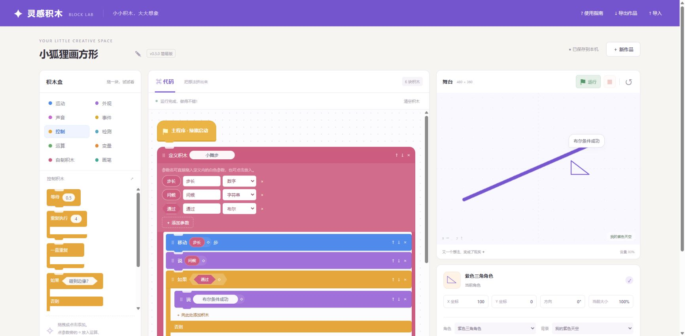

# 灵感积木 · 简易 Scratch

一个中文图形编程工作台。v0.3.0 提供九类积木及画笔扩展、72 个积木盒入口、可拖动的具名参数、自定义角色/背景和录音素材。保留三个原创角色、三个背景和四个示例。

[GitHub 源码](https://github.com/xiaoxuhui/mini-scratch)；MIT 许可，原创角色图形随代码一起授权。可作为游戏大厅的独立动态资源安装。

大厅已接入灵感积木，版本更新记录见 [接入报告](doc/GitHub与大厅接入报告.md)。大厅 v0.4.0 及以上点“立即检查” → “游戏目录” → “灵感积木”安装，无需更换 APK。

## 直接使用

双击 `dist/play.html`，无需安装依赖，也无需联网。文件页面的本地保存行为因浏览器而异，重要作品请导出备份。

点击积木添加到程序末尾，或拖到指定位置。循环底部的「向此循环添加积木」按钮可切换点击添加位置，适合触摸设备。↑↓ 调整同层顺序，× 删除，撤销最多保留 30 次编辑（刷新后清空撤销历史）。点击绿旗运行，红方块停止，↺ 复位。

舞台中心为 (0,0)，x 向右、y 向上。方向 0° 朝右，右转 90° 朝下。每次启动都会回到中心并清除画迹。作品自动保存到当前浏览器，包含程序、角色和背景，不包含运行状态。

控制类容器向右开口，重复和条件分支保留独立嵌套空间。

点参数旁的 ◇，选择运算、检测或变量返回值，可继续嵌套表达式。运动分类的当前 X、Y、方向，外观分类的大小、造型/背景编号，以及声音分类的音量可直接参与运算，放入步数或数字参数。真假返回值与条件槽采用左右尖角、上下平直的六边形。

“定义积木”放在程序最外层，点击“添加参数”，填写名称并选择数字、字符串或布尔类型。直接拖动参数名到定义内的输入槽，或点击参数名选择放入位置；调用积木同步显示各个参数。改名保留引用，删除参数会清理引用与调用值，可撤销恢复。参数自由增删，受作品的 2000 参数节点预算限制。旧单参数作品升级保留原值语义，类型暂显示“旧值”；明确选择类型后启用转换。

舞台下方“导入 / 绘制”管理角色与背景，支持 PNG/JPEG/WebP、画笔、橡皮、清空、笔画撤销及修改已保存素材。声音分类“录入 / 管理声音”可录音、导入、试听和保存，使用“播放声音”积木运行；每段最长30秒，素材合计2MB，作品导入最大4MB。媒体内嵌于作品，不上传；关闭录音窗、切到后台或离开页面会停止录音。需要支持麦克风的浏览器与权限；当前大厅 APK 0.4.2 未开放麦克风，可先导入系统录音文件。

事件积木放在最外层；先点绿旗，再按键或点击角色。第一次声音运行由点击绿旗启用。变量分类可新建变量，舞台下显示运行值。推荐试试“积木音乐派对”。

新版优先读取 v3，其次 v2、v1；首次写入时保留旧槽与不可覆盖的升级备份。v3 独立保存，回退旧版本不会覆盖新版作品，各版本后续编辑不自动合并。

## 开发与稳定本地保存

需要 Node.js 20+，无第三方依赖。在项目目录运行：

```powershell
node --test
node scripts/build.mjs
node scripts/verify-build.mjs
node scripts/serve.mjs
```

浏览器打开 http://localhost:4178。`npm test`、`npm run build`、`npm start` 为等价入口（环境需有 npm）。Ctrl+C 停止服务。也可把 dist 放在任意静态服务器上。

## 范围与验证

本版本为单角色入门原型，尚无多角色、角色间碰撞或 .sb3 格式兼容。JSON 是本项目独立格式。

56 项自动化测试通过；本次真实 Chrome 检查了绘图保存与重载、三类具名参数、真假分支、当前大小传值、重命名/删除/撤销，以及手机布局。原生拖拽自动化受浏览器扩展错误影响，文件选择器往返、真实麦克风及 Android 真机未列为通过。详见 [v0.3 测试报告](doc/v0.3-测试报告.md)。

[v0.2.1形状验收](doc/v0.2.1-测试报告.md)


