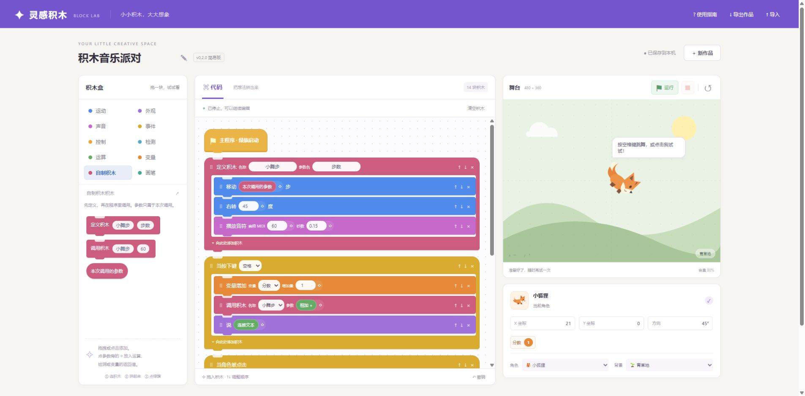

# 灵感积木 · 简易 Scratch

一个中文图形编程工作台。v0.2.0 提供 69 种积木：运动、外观、声音、事件、控制、检测、运算、变量、自制积木，以及画笔扩展；三个原创角色、三个背景和四个示例。

[GitHub 源码](https://github.com/xiaoxuhui/mini-scratch)；MIT 许可，原创角色图形随代码一起授权。可作为游戏大厅的独立动态资源安装。

大厅已接入灵感积木，版本更新记录见 [接入报告](doc/GitHub与大厅接入报告.md)。大厅 v0.4.0 及以上点“立即检查” → “游戏目录” → “灵感积木”安装，无需更换 APK。

## 直接使用

双击 `dist/play.html`，无需安装依赖，也无需联网。文件页面的本地保存行为因浏览器而异，重要作品请导出备份。

点击积木添加到程序末尾，或拖到指定位置。循环底部的「向此循环添加积木」按钮可切换点击添加位置，适合触摸设备。↑↓ 调整同层顺序，× 删除，撤销最多保留 30 次编辑（刷新后清空撤销历史）。点击绿旗运行，红方块停止，↺ 复位。

舞台中心为 (0,0)，x 向右、y 向上。方向 0° 朝右，右转 90° 朝下。每次启动都会回到中心并清除画迹。作品自动保存到当前浏览器，包含程序、角色和背景，不包含运行状态。

点参数旁的 ◇，选择运算、检测或变量返回值，可继续嵌套表达式。事件积木和“定义积木”放在程序最外层；先点绿旗，再按键或点击角色。声音使用浏览器合成音符，第一次运行由点击绿旗启用。变量分类中可新建变量、设置初始值；舞台下方显示运行值。自制积木支持一个参数与嵌套调用，定义中的“本次调用的参数”读取传入值。推荐先运行“积木音乐派对”，按空格跳舞，点击角色触发广播。

新版首次读取旧版作品时，会保留旧存档并写入独立的新版存档。回退 0.1.0 可继续打开旧作品，新版作品仍保留给 0.2.0；两个版本之间的后续编辑不会自动合并。

## 开发与稳定本地保存

需要 Node.js 20+，无第三方依赖。在项目目录运行：

```powershell
node --test
node scripts/build.mjs
node scripts/verify-build.mjs
node scripts/serve.mjs
```

浏览器打开 http://localhost:4178。`npm test`、`npm run build`、`npm start` 为等价入口（环境需有 npm）。Ctrl+C 停止服务。也可把 dist 放在任意静态服务器上。

## 范围与验证

本版本为单角色入门原型。支持条件与循环、合成音符、并发事件、变量、嵌套运算与单参数自制积木；尚无多角色、角色间碰撞、音频素材录制或 .sb3 格式兼容。JSON 是本项目独立格式。

42 项自动化测试通过；真实 Chrome 验证了分类、参数表达式、编辑持久化、按键与点击事件、广播、变量终值、自制调用、停止、手机布局及单文件产物。新增返回值拖拽和文件导入导出往返未列为通过，点击参数的替代路径已验证。详见 [v0.2 测试报告](doc/v0.2-测试报告.md)。


